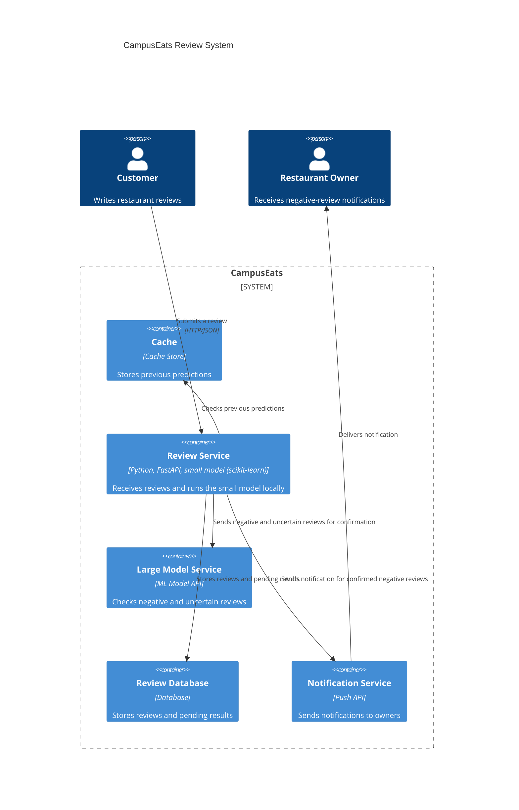

# Task 4: Deployment topologies and trade-offs
 
**Name:** Htet Aung Lin
 
**Student ID:** 01326140
 
This is **individual work**: each student completes and submits their own copy, in their own fork.
 
Design a deployment for the scenario below. Use your measurements from Tasks 0–3 as evidence: cite run names from `results/runs.csv`. Answer in English.
 
## Scenario: Owner alerts
 
When a customer posts a negative review, the restaurant owner gets a push notification within **2 seconds**. At the lunch peak, CampusEats receives **40 reviews per second**. A missed alert is acceptable, but a wrong alert (for example, "your customer is unhappy" when they are happy) makes owners stop trusting alerts and, in the end, ignore them.
 
Facts:
 
- The large model serves at most **20 calls per second** (4 calls at once × about 200 ms each), and every call costs money.
- The small model is fast and cheap enough to run anywhere, including inside the review service, but it is much less accurate on its own.
## Topologies and patterns to choose from
 
| | Topology | Where the model runs |
|---|---|---|
| T1 | Model as a service, synchronous | Inference service, called for each review (today's baseline) |
| T2 | Model as a library | Inside the review service, or on the device |
| T3 | Hybrid | Small model locally, large model as a remote service |
| T4 | Asynchronous / batch | Reviews are queued or stored, and scored later in bulk |
 
Combine one topology with any of the patterns from Tasks 1–3: **fallback**, **cascade** and **cache**.
 
## 1. Quality requirements
 
The three most important quality requirements for this scenario, each with a number where possible.
 
| # | Quality | Requirement |
|---|---|---|
| 1 | Accuracy | At least 95% precision for negative alerts to avoid sending wrong notifications. |
| 2 | Response time | Send a push notification within 2 seconds after a negative review is posted. |
| 3 | Scalability | Handle 40 reviews per second while keeping large-model calls at most 20 per second. |
 
## 2. Design
 
Your topology, the patterns you add, and a container-level diagram (C4 level 2). The C4 diagram must be written in Mermaid.
 
I would choose T3 Hybrid and combine it with cascade, cache and fallback, using a confidence threshold of 0.7.
 
First, every review goes through the small model inside the review service because it is fast and cheap. If the small model confidently predicts a positive review, the system accepts that prediction without calling the large model. However, if it predicts a negative review, the review is always sent to the large model for confirmation, even if the small model is confident. Uncertain reviews are also sent to the large model.
 
The system also uses a cache to reuse previous predictions when the same review appears again. If the large model confirms that a review is negative, the system sends a notification to the restaurant owner. However, if the large model fails or takes too long, the review is saved as pending instead of sending a notification without confirmation.
 
I chose this design because sending a wrong notification could make restaurant owners lose trust in the system. It is better to miss some negative reviews than to send too many incorrect notifications.
 

 
## 3. Evidence
 
Which runs support your choice? Show the numbers and the capacity arithmetic: how many large-model calls per second does your design need at the peak?
 
The results show that using only the large model is not a good choice because every review needs a large-model call (`t0-large`, 100%). At 40 reviews per second, this would exceed its maximum capacity of 20 calls per second.
 
Using only the small model is also not a good choice because its accuracy is only 72.5% (`t0-small`).
 
For the cascade, `t2-0.7` achieved 93.0% accuracy but used 53% large-model calls. The `t3-cache` result achieved the same accuracy but reduced large-model calls to 38%, with a 35% cache-hit rate.
 
At peak traffic, 40 × 38% = 15.2 large-model calls per second. This is equivalent to 76% of the large model's maximum capacity. However, this 38% rate was measured using the original cascade, not my design where every negative prediction is checked by the large model. Therefore, the actual call rate could be higher and needs further testing. The large model can handle at most 50% of reviews at this traffic level because 20 ÷ 40 = 50%.
 
The p95 latency of `t3-cache` was 549 ms, which is below the 2-second target. However, this result was measured with 10 requests in flight, not at 40 reviews per second. At peak traffic, the large model may have longer queues, so meeting the 2-second target still needs to be tested.
 
The fallback experiment also showed that adding a timeout reduced errors from 26 (`t1-before`) to zero (`t1-after`), although 22 reviews became pending.
 
| Run | What it shows |
|---|---|
| `t0-large` | Accuracy was 93.5%, but every review used the large model. |
| `t0-small` | It was fast, but accuracy was only 72.5%. |
| `t2-0.7` | Cascade achieved 93.0% accuracy with 53% large-model calls. |
| `t3-cache` | Accuracy stayed at 93.0%, while large-model calls dropped to 38%. Cache hits were 35%. |
| `t1-after` | Timeout reduced errors to zero, but 22 reviews became pending. |
 
One limitation is that these experiments measured overall accuracy, not precision for negative reviews specifically. Therefore, the 95% precision target still needs to be tested.
 
## 4. ADR
 
An **architecture decision record (ADR)** is a short document that records one design decision: the situation that forced it (context), what you decided, and what follows from it, good and bad (consequences). Fill in the template below.
 
**Title:** Use T3 Hybrid with Cascade, Cache and Fallback (Threshold 0.7).
 
**Status:** Proposed
 
**Context:**
 
CampusEats needs to notify restaurant owners when customers post negative reviews. The notification should arrive within 2 seconds, and the system needs to handle 40 reviews per second during lunch peak hours.
 
The large model is more accurate but can only handle 20 calls per second. The small model is faster and cheaper, but its accuracy is lower. Sending every review to the large model would exceed its capacity.
 
**Decision:**
 
I decided to use T3 Hybrid with cascade, cache and fallback, using a confidence threshold of 0.7.
 
The small model will check every review inside the review service. Confident positive reviews will be accepted without calling the large model. However, all negative predictions and uncertain reviews will be sent to the large model for confirmation. The cache will help avoid processing repeated reviews again.
 
Only reviews confirmed as negative by the large model will trigger notifications. If the large model fails or times out, the review will be saved as pending instead of sending an unconfirmed notification.
 
**Consequences:**
 
- **Positive:**
  - Reduces large-model calls compared with sending every review to the large model.
  - Confirms negative predictions before sending notifications.
  - The small model can handle confident positive reviews quickly.
  - Cache avoids repeating the same work.
  - Fallback prevents requests from waiting too long.
- **Negative:**
  - The system is more complicated than using only one model.
  - Some negative reviews might be missed.
  - More reviews may go to the large model than in the experiments, so its capacity is less certain.
  - The cache needs to be updated when a new model is deployed.
  - Pending reviews may not receive notifications immediately.
  - After a model update, the cache may be empty and the large-model call rate may increase. In the original experiment without cache, it was 53%, which would mean 40 × 53% = 21.2 calls per second. This is higher than the model's capacity of 20 calls per second.
  
**Alternatives considered:**
 
**T1 – Model as a Service**
 
I rejected T1 because the small model would run as a separate inference service. Even easy reviews would need a network call to that service. If the service became unavailable, reviews could not be labelled by the small model. In T3, the small model runs inside the review service, so easy reviews can be handled locally.
 
**T2 – Model as a Library**
 
I rejected using only the small model because its accuracy is only 72.5%, which is too low for this scenario.
 
**T4 – Asynchronous / Batch**
 
I did not choose this as the main design because reviews might be processed too late to meet the 2-second notification requirement.
 